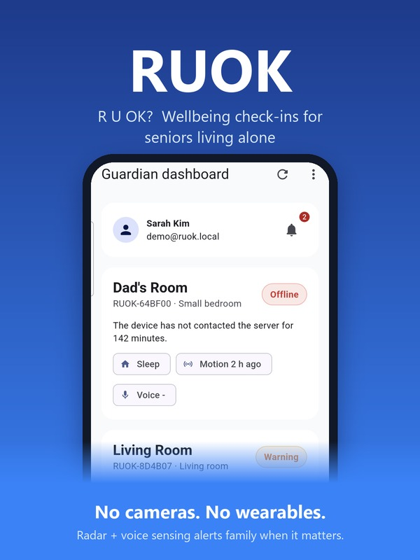

# RUOK — R U OK?

**A wellbeing check-in system for seniors who live alone.**



Many older adults live alone. If they fall or suddenly get sick, nobody may notice for hours or even days. RUOK checks on a loved one quietly — **no camera, nothing to wear, nothing to press**. A small sensor device at home notices everyday signs of activity, and if those signs stop for longer than expected, the guardian app shows an alert to the family.

Built for the [Congressional App Challenge](https://www.congressionalappchallenge.us/) 2026.

<br clear="right"/>

## How it works

```
 Home device (Raspberry Pi)          Server (FastAPI)                 Guardian app (Flutter)
 ┌──────────────────────────┐  HTTPS ┌───────────────────────────┐    ┌──────────────────────┐
 │ LD2410C 24GHz radar ──┐  │ ─────▶ │ stores events             │ ◀─ │ dashboard            │
 │ ICS-43434 mic (RMS) ──┼─▶│ events │ computes status:          │    │ alerts               │
 │ heartbeat every 60s ──┘  │        │ Normal/Warning/Urgent/    │    │ alert rules, sleep,  │
 │ offline queue (SQLite)   │        │ Offline + creates alerts  │    │ away mode, add device│
 └──────────────────────────┘        └───────────────────────────┘    └──────────────────────┘
```

| Part | Folder | Tech |
|---|---|---|
| Home device | [`device/`](device/) | Python on Raspberry Pi Zero 2 W, LD2410C radar, ICS-43434 I2S mic |
| Server | [`web/`](web/) | Python, FastAPI, SQLite |
| Guardian app | [`app/`](app/) | Flutter (Android) |

## Features

- **Dashboard** — status of every room at a glance (Normal / Warning / Urgent / Offline)
- **Easy setup** — add a device in the app, then send it home Wi-Fi details through its setup hotspot (no screen or keyboard on the device)
- **Activity history** — recent motion and voice events
- **Alerts** — Warning and Urgent alerts for inactivity, Offline alert when the device stops reporting
- **Custom alert rules**, **sleep schedule**, and **away mode** to avoid false alarms
- **Works through internet outages** — the device queues events locally and resends them later
- **Privacy by design** — no camera; audio is reduced to a loudness value and never recorded or stored

## Hardware

See [`device/PARTS.md`](device/PARTS.md) and [`device/hardware_wiring_notes.md`](device/hardware_wiring_notes.md).

## Running it

**Server**
```bash
cd web
python -m venv .venv && .venv/Scripts/activate   # Windows (use bin/activate on Linux/macOS)
pip install -r requirements.txt
python main.py                                   # http://127.0.0.1:8787
```

**Device** (Raspberry Pi) — see [`device/README.md`](device/README.md). Use `"mode": "mock"` in `config/config.json` to test without sensors.

**Demo without hardware** — [`device/demo_simulator.py`](device/demo_simulator.py) sends motion / voice / heartbeat events from the keyboard:
```bash
cd device
python demo_simulator.py --server http://127.0.0.1:8787 --uid RUOK-XXXXXX --token dev_xxxxx
```

**App**
```bash
cd app
flutter run --dart-define=RUOK_BASE_URL=http://<server-ip>:8787
```

## Team & AI use

Built by a team of two. We used Claude Code (an AI coding assistant) for debugging, some code changes, and editing our submission materials; our team designed the system, built and soldered the hardware, and tested and finalized the project.
